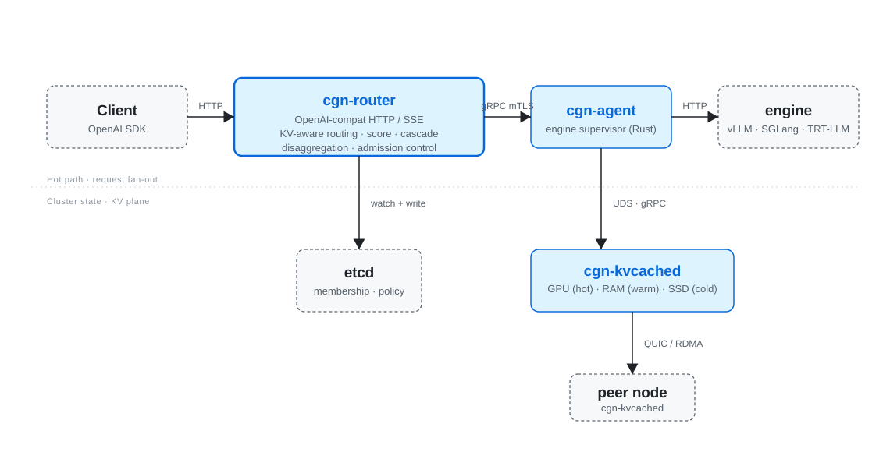

# Cognitora architecture

> One-page technical overview. For repo and crate layout see
> [`architecture/repo-layout.md`](architecture/repo-layout.md). For the
> full configuration reference see [`reference/config.md`](reference/config.md).
> Per-component guides for each shipped binary live under
> [`platform/`](platform/README.md).

## 1. Topology

  

Every box is a single statically-linked Rust binary. `cgn-metrics`,
`cgn-ctl`, and `cgn-operator` are shown elsewhere; they sit alongside
the four hot-path daemons above.

## 2. Hot path

A request travels:

1. **HTTP ingress**: `cgn-router` accepts an OpenAI-compatible request
   on `:8080`. Auth is checked by `cgn-auth` (API key in
   `Authorization: Bearer ...` or OIDC bearer with JWKS rotation).
   Rate limiting is applied by `cgn-ratelimit`, keyed on the
   authenticated principal, else the client IP. Handlers then check
   scopes, model access and token limits.
2. **Tokenize**: the prompt becomes token ids through the model's
   `tokenizer.json`, or a built-in estimate when none is configured.
3. **Admission**: `Admission::admit` takes a slot for the (model, role)
   pair. At `max_queue` the request parks in its tenant's wait queue,
   and freed slots rotate across tenants. A full queue or a wait
   timeout returns 429.
4. **Digest**: the gateway hashes the ids into **sequence-chained
   BLAKE3 digests** (each chunk's digest covers all preceding tokens),
   salted by model and tenant. Two requests with identical chunks in
   different positions never collide, and tenants never share a digest.
5. **Score**: for every ready node serving the requested model or
   adapter, `routing::score` computes
   `total = w_kv·longest_prefix + w_load·load + w_pwr·power + w_cap·capacity`
   using the policy from etcd (live-updated via `arc_swap`). The load
   term includes the router's own in-flight count, and a session's
   rendezvous-hashed node gets a bonus. The highest score wins.
6. **Forward**: the gateway opens an `Agent.Generate` gRPC stream on a
   pooled channel (mTLS when `require_mtls` is on). `cgn-agent` proxies
   the stream to the engine subprocess (`vllm`, `sglang`, `llama_cpp`,
   `mlx`, `tensorrt_llm`, `cgn_infer` or `openai_compat`, selected by
   `[engine].kind`; pluggable through the `Engine` trait).
7. **First token**: the gateway waits for it before committing to a
   response. Failures so far retry on another node, up to three
   attempts, or return a real HTTP error.
8. **Stream out**: tokens flow back through the gRPC stream and are
   re-encoded as OpenAI SSE chunks by `gateway::sse`, followed by usage
   from the engine. A later failure ends the stream with an error
   event and no `[DONE]`.

For long prompts, the optional **disagg** path replaces step 5 with a
two-stage flow: a prefill agent runs the first forward pass and emits
KV blocks via the engine's `--kv-transfer-config` connector
(`NixlConnector`, optionally stacked with `LMCacheConnectorV1` or
`DynamoConnector(KVBM)`; see [`architecture/kv-strategy.md`](architecture/kv-strategy.md));
the decode agent consumes them and streams the rest of the response.

## 3. Cluster state

`etcd` holds:

* `/cognitora/nodes/<node_id>`: `NodeHealth` JSON written by every
  `cgn-agent` every `[agent].heartbeat` (default 5 s). Stale entries
  are filtered out by `routing::pick`.
* `/cognitora/routing/policy`: score weights + admission tunables,
  written by `cgn-operator` from a `RoutingPolicy` CRD or by
  `cgn-ctl cluster set-policy` for non-K8s deploys.

There is no PostgreSQL, MySQL, or KV-store-of-the-week dependency:
etcd is the *only* coordination service.

## 4. KV cache

Cognitora separates KV management into **four layers** that compose:

| # | Layer                          | Owner                                  |
|---|--------------------------------|----------------------------------------|
| 1 | Engine-internal KV (GPU HBM)   | vLLM / SGLang / llama.cpp / TRT-LLM    |
| 2 | Engine-side offload connector  | `LMCache` · `HiCache` · `KVBM` · `NIXL` (selected via `engine.kv_offload`) |
| 3 | Cross-worker KV transfer       | `NixlConnector` (vLLM) or NIXL inside KVBM/HiCache |
| 4 | Cross-cluster KV-aware routing | `cgn-kvcached` + `cgn-router`          |

`cgn-kvcached` runs once per GPU host and exposes
`cognitora.v1.Kv` over gRPC + a QUIC transport. It owns:

* **RAM tier (warm)**: a `RamTier` keyed by `BlockAddress` (model digest +
  layer). Eviction is approximate-LRU.
* **SSD tier (cold)**: block files under `/var/lib/cognitora/kv/ssd/`. The
  metadata index is RocksDB by default; an in-memory fallback exists
  for dev builds (see the `persistent-index` feature).
* **GPU residency index**: a window of pinned-block addresses
  reported by the engine, so the router can answer "is this prefix on
  this GPU right now?" without traversing the engine.

Cross-host fetches use QUIC (1-RTT, 0-RTT for re-tries on the same
peer). The wire format is binary `Frame { addr, model, layer, bytes }`
with bincode-encoded headers.

For the deep dive on layer 2 (engine-side offload), including the
LMCache vs HiCache vs KVBM matrix, see
[`architecture/kv-strategy.md`](architecture/kv-strategy.md).

## 5. Power and energy

`cgn-power` reads:

* **Redfish** out-of-band power (chassis + per-PSU draw),
* **IPMI** as a fallback,
* **NVML** per-GPU power.

`cgn-metrics` exports those readings as `cgn_power_watts{component=...}`
gauges. The router subscribes to the metrics endpoint and incorporates
the result into the `power` term of the routing score, biasing requests
toward energy-efficient nodes when the operator turns the weight up.

## 6. Security

* **mTLS** covers gRPC and QUIC when `[security].require_mtls = true`.
  It is off by default for local use, and a public QUIC listener refuses
  to start without it unless explicitly allowed. `cgn-tls` loads PEM
  material and generates dev PKI (rcgen).
* **API auth**: API keys (sha256-hashed, re-read every 15 s) and OpenID
  Connect bearer tokens (validated against JWKS). Scopes grant endpoints
  and models, assign tenants, and set token limits.
* **Tenant isolation**: prefix digests are salted per tenant, and vLLM
  gets a matching `cache_salt`.
* **Distroless images** with `nonroot` UID; no shell in production
  containers.
* All commits land on a release branch only after `clippy -D warnings`,
  `cargo test`, and `helm lint` pass in CI.

## 7. Capabilities

| Area                    | What ships                                                          |
|-------------------------|---------------------------------------------------------------------|
| Engines                 | vLLM · SGLang · llama.cpp · MLX · TensorRT-LLM · cgn-infer · OpenAI-compat |
| Single-node serving     | `cgn-router` + `cgn-agent` + `cgn-kvcached` + OpenAI HTTP/SSE       |
| Multi-node routing      | Sequence-chained BLAKE3 digests + longest-prefix overlap + load / power / capacity scoring |
| KV offload backends     | `none / nixl / lmcache / hicache / kvbm`: one TOML knob, auto-rendered into engine argv |
| Cross-node KV transport | QUIC frame codec with mTLS; RDMA is a stub; prefill/decode disagg   |
| Multi-tenancy           | OIDC group → scope mapping, virtual keys, fair queuing, in-process rate limit |
| Reliability             | Retry until the first token, drain on SIGTERM, real `/readyz`       |
| Cascade                 | SLM → Mid → LLM gated on engine logprobs                            |
| Kubernetes              | `cgn-operator` reconciles `InferenceCluster`, `ModelPool`, `RoutingPolicy` |
| Federation              | Cross-cluster forwarder in `cgn-router::federation`                 |
| Energy-aware autoscale  | Closed-loop drain hints written to etcd, picked up by the operator  |
| SLO admission           | Deadline checks in `cgn-router::deadline`, from `x-cgn-deadline-ms` or the TTFT SLO |

The [`tests/perf/`](../tests/perf) harness reports criterion benches on
every PR. The gate is soft, so a regression does not fail the build.
